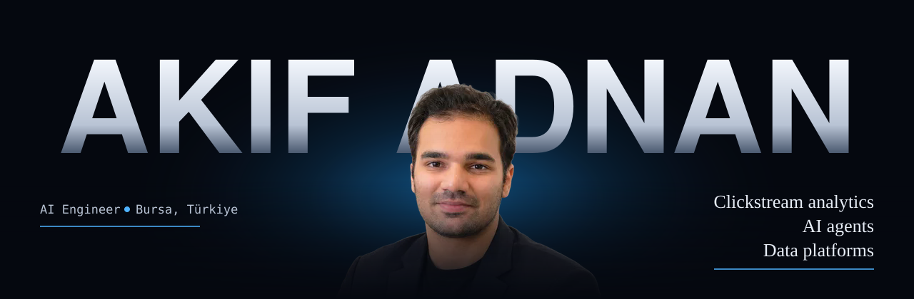

AI Engineer in Bursa, Türkiye. I build clickstream analytics, AI agents and data platforms on Google Cloud, the kind of tools teams open every morning.

  

---

### What I work on

**Clickstream and web analytics**
Site events turned into daily funnels, searches that find nothing, filters that lead nowhere, and sales by channel: for every product, how much came from ads, search, direct visits, email, referrals and AI assistants.
    

**AI agents and automation**
A real-time voice agent that replies to callers in about 700 ms, with the conversation steered by code and every reply checked. Support automation that triages tickets and drafts replies from company knowledge.
    

**Data platforms**
Reporting tables that rebuild every night, a live delivery dashboard across several carriers, hourly risk scoring and data quality checks.
   

**Language and voice**
Call transcription, phone menus in 17 languages, multilingual ticket classification and Turkish part-of-speech tagging (90.9% on the standard treebank).
  

Most of this work lives in private repositories. Write-ups are on [my website](https://akifadnan2003.github.io).

---

### Public projects

| Project | What it is |
| :-- | :-- |
| [**SpeakLab**](https://github.com/akifadnan2003/speak-lab) | A speaking-first English academy app for a tutor and their students. React, TypeScript, Supabase. |
| [**MediNav Kiosk**](https://github.com/akifadnan2003/MediNav-Kiosk) | An offline, multilingual help kiosk for hospital visitors, with speech recognition running on the device. |
| [**NetProbe**](https://github.com/akifadnan2003/Net-Probe) | A network protocol on top of UDP, compared against TCP. |
| [**Parallel point-in-polygon**](https://github.com/akifadnan2003/Paralel-Point-in-Polygon-Tespiti) | A parallel version of a heavy geometry workload, 4.42x faster than the sequential one. |
| [**This website**](https://github.com/akifadnan2003/akifadnan2003.github.io) | Plain HTML, CSS and JavaScript, in English and Turkish. |

---

### Tools I use most

      
     
